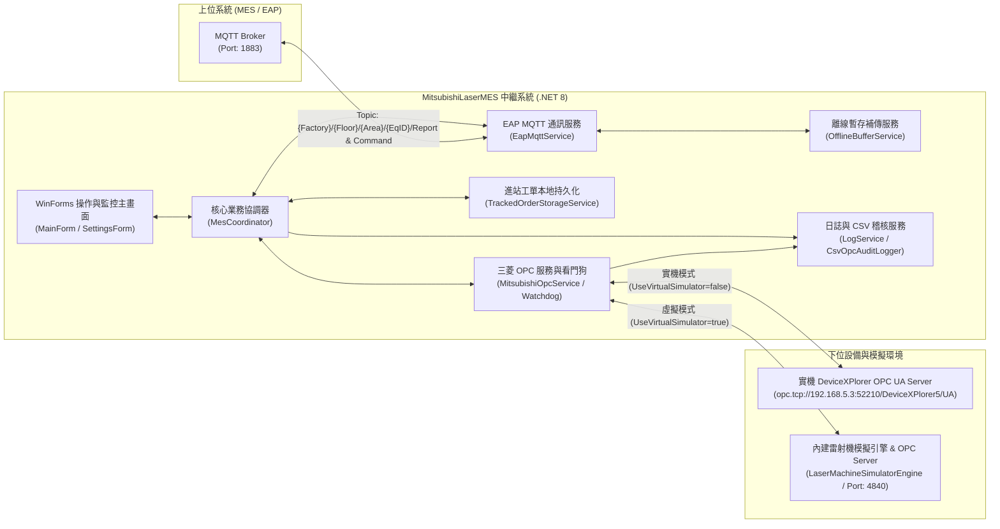
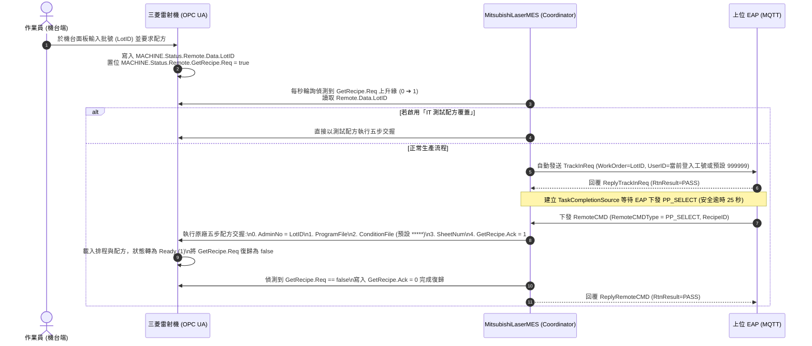

# 三菱 CO2 雷射加工機 MES 中繼系統 (MitsubishiLaserMES) 專案交接文件

> [!IMPORTANT]
> 本文件為 **MitsubishiLaserMES** 專案之完整技術與維運交接指南，涵蓋系統架構、通訊協定細節（上位 EAP MQTT 與下位三菱雷射機 OPC UA）、核心交握時序、組態設定、日誌稽核機制及現場故障排除程序。

---

## 1. 專案總覽與系統定位

### 1.1 系統目標
**MitsubishiLaserMES** 是一套專為台南廠區 **三菱 CO2 雷射盲孔鑽孔機（型號如 ML605GTF / 規格書 S26888-C / 機台代碼 DR0026）** 打造的工業自動化 MES/EAP 中繼軟體（Middleware）。
其核心職責為扮演 **上位 EAP 系統（BC / MES）** 與 **下位三菱雷射加工機（透過 TAKEBISHI DeviceXPlorer OPC Server）** 之間的雙向通訊橋樑：
- **向上（對 EAP）**：透過 **MQTT** 協定（JSON 信封格式）處理人員刷卡驗證、工單進站（Track-In）、工單出站（Track-Out）、遠端控制指令（`RemoteCMD`，如 `PP_SELECT`、`START`、`STOP`）、機台三色燈與 13 種狀態變更上報、警報即時上報、加工計數製程資料上報，以及雙向存活探測（`AreYouThere` / `IamHere`）。
- **向下（對雷射機）**：透過 **OPC UA** 協定讀寫設備節點，執行每 1 秒一次的 **Host WatchDog 心跳遞增**、每秒輪詢機台狀態與警報 Slot、自動切換 `SEMI-AUTO` 模式，以及嚴格遵循三菱原廠規範的 **五步配方交握時序（Recipe Handshake）**。

### 1.2 系統拓樸架構圖



---

## 2. 開發環境與技術棧

| 類別 | 規格 / 套件名稱 | 版本 / 說明 |
| :--- | :--- | :--- |
| **開發框架** | .NET SDK | `.NET 8.0` (`net8.0` / `net8.0-windows`) |
| **使用者介面** | Windows Forms (WinForms) | 支援中/英文雙語動態切換、Visual Studio Designer 視覺化排版 |
| **MQTT 客戶端** | `MQTTnet` | `4.3.7.1207`（支援 QoS 1 `AtLeastOnce`、斷線每 5 秒自動重連） |
| **OPC UA 核心** | `OPCFoundation.NetStandard.Opc.Ua` | `1.5.378.156`（含 Client 與內建 Simulator Server） |
| **JSON 序列化** | `Newtonsoft.Json` | `13.0.4` |
| **公司通訊核心庫** | `Protocol.Core.dll` | 放置於 `dll/Protocol.Core.dll`，封裝公司標準 EAP Message 與 Enum |

---

## 3. 解決方案與目錄結構詳解

解決方案檔為 `MitsubishiLaserMES.sln`，共包含 3 個核心專案與周邊文件目錄：

### 3.1 專案清單
1. **`src/MitsubishiLaserMES.Core`** (`net8.0` 核心類別庫)
   - `Common/`：通用列舉 `MachineEnums.cs`（13 種機台狀態燈號、三菱狀態碼、OPC 模式）與時間格式化工具 `DateTimeUtils.cs`。
   - `Logging/`：零第三方套件依賴的執行緒安全日誌服務 `LogService.cs` 與自動壓縮/清理背景排程 `LogMaintenanceService.cs`。
   - `Models/Config/`：系統設定模型 `AppConfig.cs` 與動態機台字典模型 `EquipmentProfile.cs`。
   - `Models/Eap/`：所有 EAP 通訊 DTO 與標準信封 `EapEnvelope.cs`。
   - `Opc/`：三菱雷射機 OPC UA 完整節點目錄 `LaserOpcNodeCatalog.cs`、實機客戶端 `MitsubishiOpcUaClient.cs`、虛擬客戶端 `VirtualOpcUaClient.cs`、模擬 OPC UA Server `LaserOpcServerHost.cs` 及 CSV 通訊稽核紀錄器 `CsvOpcAuditLogger.cs`。
   - `Services/Coordination/`：業務邏輯中樞 `MesCoordinator.cs` 與未出站工單持久化服務 `TrackedOrderStorageService.cs`。
   - `Services/Eap/`：MQTT 雙向通訊服務 `EapMqttService.cs` 與離線斷網暫存佇列 `OfflineBufferService.cs`。
   - `Services/Opc/`：三菱 OPC 業務封裝 `MitsubishiOpcService.cs` 與原廠看門狗心跳 `OpcWatchdogService.cs`。
   - `Simulator/`：三菱雷射機狀態機與配方交握模擬引擎 `LaserMachineSimulatorEngine.cs`。

2. **`src/MitsubishiLaserMES.WinForms`** (`net8.0-windows` 主應用程式)
   - `Program.cs`：程式進入點，配置全域例外攔截、初始化 `LogService`、`LogMaintenanceService`、`MesCoordinator` 並啟動主視窗。
   - `Forms/MainForm.cs`：現場作業員與工程師操作主畫面（包含人員條碼認證、工單作業頁籤、設備狀態與警報頁籤、IT 測試與配方交握調試頁籤）。
   - `Forms/SettingsForm.cs`：MQTT 與 OPC UA 連線參數設定對話框。
   - `Forms/MaskWaitForm.cs` / `Forms/TerminalMessageForm.cs`：非同步等待遮罩與 EAP 遠端終端訊息彈窗。

3. **`src/MitsubishiLaser.Simulator`** (`net8.0-windows` 機台模擬器視窗專案)
   - `Forms/SimulatorMainForm.cs`：可獨立啟動、亦可從主程式「設備功能」頁籤點擊「開啟機台模擬器」喚出的視覺化雷射機模擬面板，同時在背景啟動標準 OPC UA Server (`opc.tcp://0.0.0.0:4840`)。

### 3.2 重要靜態資源與文件目錄 (`Dictionaries/` & `DOC/`)
- `Dictionaries/DR0026.json`：定義 DR0026 機台之事件代碼（`Events`，如 `104: USER_VERIFY`）、變數代碼（`Variables`，如 `1028: User_Barcode`）、狀態碼與警報映射字典。
- `DOC/`：
  - `機台自動化通訊協定規範V1.0.6.pdf`：公司 EAP MQTT 通訊協定規範書。
  - `OPC_SPEC.pdf`：三菱 CO2 雷射加工機（S26888-C）原廠 OPC 通訊規格書。
  - `Log機制.txt`：日誌分層目錄、單檔滾動與自動 ZIP 壓縮維運規範。
  - `DOC/Recipe/`：現場機台 `pbn_opc_std.ini`、`schedule.ini`、`cndsrch.ini` 以及實機配方範例（`.prg`, `.cnd`, `.sdl`, `.drl`, `.glv`, `.hgd`）。

---

## 4. 核心業務流程與交握時序

核心協調器 `MesCoordinator.cs` 整合了所有跨系統事件。以下為關鍵業務流程與時序圖：

### 4.1 程式啟動與自動切換 `SEMI-AUTO` 模式
1. 程式啟動時，`MainForm.Load` 自動呼叫 `MesCoordinator.InitializeAsync()`，平行建立 **EAP MQTT 連線** 與 **機台 OPC UA 連線**。
2. 當 OPC 連線成功建立後（無論是啟動時或斷線重連觸發 `OnOpcConnectionStateChanged`），若偵測到機台目前非 `OnlineSemiAuto (2)` 模式，系統會自動延遲 500ms 後呼叫 `SwitchOpcModeAsync(2)`，將機台切換為 **SEMI-AUTO（半自動線上模式）**。
   > [!NOTE]
   > 依據三菱原廠規範 4-1，**僅在機台處於 `Idle (3)` 閒置狀態時，機台才會接受 OPC 模式切換**（回覆 `ChangeOpcMode.Ack = 1`）；若機台處於運轉中則會拒絕（`Ack = -1`）。

### 4.2 兩種工單進站（Track-In）與配方下發路徑

系統支援 **「中繼軟體 UI 手動進站」** 與 **「作業員於雷射機台面板輸入 LotID 自動觸發進站」** 兩種生產作業模式：

#### 模式 A：作業員於雷射機台面板輸入 LotID（機台主動觸發 `GetRecipe.Req`）
這是現場最核心的自動化流程（實作於 `MesCoordinator.ProcessMachineRecipeRequestAsync`）：



> [!WARNING]
> **異常防護機制**：
> - 若機台送出的 `LotID` 為空白、或 EAP 未連線（非綠燈）、或 `TrackInReq` 被 EAP 拒絕、或等待 EAP 下發 `PP_SELECT` 超過 **25 秒**，系統皆會主動呼叫 `RejectRecipeHandshakeAsync(-1)`，向機台寫入 `GetRecipe.Ack = -1`，待機台將 `GetRecipe.Req` 降為 `false` 後再復歸 `GetRecipe.Ack = 0`，防止機台無限期卡死等待。
> - 若現場作業員未先在中繼軟體刷卡登入，機台觸發自動進站時會自動帶入預設工號 `999999` (`DefaultFallbackOperatorId`)。

#### 模式 B：作業員於中繼軟體 UI 手動點擊「工單進站」
1. 作業員先於主畫面左上方掃描工號二維條碼（發送 `EventReport` `CEID=104` `USER_VERIFY`），EAP 驗證通過後於 `RtnMsg` 回傳人員工號並完成登入。
2. 輸入或掃描工單號碼後點擊「工單進站」，發送 `TrackInReq` 至 EAP。
3. 進站成功後：
   - 工單寫入本機 `data/tracked_orders.json` 持久化保存。
   - 若機台目前為 `OnlineAuto (3)` 全自動模式，中繼軟體會在 300ms 後自動發送 `StartSchedule.Req = true` 啟動連續加工；若為 `OnlineSemiAuto (2)` 半自動模式，則等待作業員於機台端按下啟動按鈕。

### 4.3 配方路徑決策優先權（3 層覆蓋機制）
當收到 EAP 下發 `PP_SELECT` 或機台請求配方時，系統決定 `ProgramFile` 與 `ConditionFile` 的優先順序如下：
1. **優先權 1（最高）：IT 測試功能手動指定**（主畫面「IT 測試功能」頁籤勾選「啟用測試配方覆蓋機台請求」）。
2. **優先權 2：主畫面「手動指定加工程式」欄位**（`txtManualProgramPath` 若非空白，將於 `PP_SELECT` 時優先取代 MES 下發的 `RecipeID`）。
3. **優先權 3（預設）：EAP `PP_SELECT` 下發之 `RecipeID`**（自動與 `appsettings.json` 中的 `Opc.RecipeDirectory` 組合，並在寫入 OPC 時經由 `NormalizeRecipeFileName` 處理）。
- **加工條件檔 (`ConditionFile`)**：若主畫面「加工條件檔名」(`txtConditionFile`) 未填寫，預設自動填入三菱原廠規範的 `"*****"`（代表沿用機台排程預設條件檔）。

### 4.4 工單出站（Track-Out）與防卡死強制移除
- **正常出站**：點擊「工單出站」發送 `TrackOutReq`，EAP 回覆 `PASS` 後，系統自動自 `_trackedInOrders` 與 `data/tracked_orders.json` 移除該工單，並通知機台停止連續運轉。
- **防呆強制移除進站工單**：若因現場帳務異常或測試需要解除本機已進站狀態，可於「已進站工單清單」選取工單後點擊 **「移除進站」**（或按 `Delete` 鍵 / 右鍵選單），直接自本機快取強制清除該筆工單，避免畫面按鈕卡在「已進站」無法進行下一筆作業。

---

## 5. 上位 EAP (MQTT) 通訊協定實作細節

實作於 `EapMqttService.cs`，完全遵循《機台自動化通訊協定規範 V1.0.6》。

### 5.1 MQTT Topic 結構
由 `appsettings.json` 的 `Mqtt` 站點參數動態組合：
- **上傳主題 (EQ ➔ EAP)**：`{Factory}/{Floor}/{Area}/{EqID}/Report`（預設：`TN2/Floor2/Yellow/PL001/Report`）
- **下發主題 (EAP ➔ EQ)**：`{Factory}/{Floor}/{Area}/{EqID}/Command`（預設：`TN2/Floor2/Yellow/PL001/Command`）

### 5.2 標準信封格式 (`EapEnvelope<T>`)
所有發出與接收的 JSON 皆包裹於標準信封內：
```json
{
  "MessageId": "f47ac10b-58cc-4372-a567-0e02b2c3d479",
  "TimestampUtc": "2026-11-19T03:51:01Z",
  "Payload": {
    "TransactionID": "c9a646d3-9c61-4cb7-9cd0-3b8b9e1a0001",
    "CMD": "AreYouThere",
    "DATE": "20261119115101",
    "Machine": "PL001"
  }
}
```

### 5.3 支援的指令清單 (CMD Mapping)

| 方向 | CMD 名稱 | 用途說明 | 對應處理邏輯 / 備註 |
| :--- | :--- | :--- | :--- |
| **雙向** | `AreYouThere` / `IamHere` | 連線存活心跳檢測 | 每 `AliveCheckIntervalSec` (預設 30 秒) 定時發送；收到 `IamHere` 或 `AreYouThere` 立即將 EAP 狀態燈點亮為**綠燈 (`IsAliveGreen = true`)**，不檢查 `RtnResult`。 |
| **EQ ➔ EAP** | `EventReport` / `ReplyEventReport` | 人員條碼登入驗證 | `EventID` 與參數代號由 `DR0026.json` 動態查找（預設 `EventID="104"`, `EventName="USER_VERIFY"`, `Parameter="1028"`），成功時 `RtnMsg` 即為員工工號。 |
| **EQ ➔ EAP** | `TrackInReq` / `ReplyTrackInReq` | 工單進站請求 | 使用 `Protocol.Core.Messages.TrackInReqMessage` 發送，支援 T1 逾時（預設 45 秒）。 |
| **EQ ➔ EAP** | `TrackOutReq` / `ReplyTrackOutReq` | 工單出站過帳請求 | 使用 `Protocol.Core.Messages.TrackOutReqMessage` 發送，過帳成功後清除本地持久化快取。 |
| **EQ ➔ EAP** | `StatusChangeReport` | 機台 13 種燈號狀態變更 | 當 OPC 輪詢判定 `MachineStatusLight` (0~12) 改變時自動單向上報 (`OldStatus` ➔ `NewStatus`)。 |
| **EQ ➔ EAP** | `AlarmReport` | 機台警報發生與解除 | 當 OPC 警報 Slot `000`~`009` 出現新警報 (`AlarmStatus="Start"`) 或清除 (`AlarmStatus="End"`) 時自動上報。若 OPC 訊息為空則自動查閱 `DR0026.json` 的 `AlarmMapping`。 |
| **EQ ➔ EAP** | `ProcessDataReport` | 製程加工計數上報 | 當 OPC `ProcessedCount`（已加工片數）遞增時自動觸發上報 `ProcessedCount` 與 `ScheduledCount`。 |
| **EAP ➔ EQ** | `RemoteCMD` / `ReplyRemoteCMD` | 遠端控制與配方下發 | 支援 `PP_SELECT`（觸發 OPC 配方交握成功後才非同步回覆 `ReplyRemoteCMD`）、`START`、`STOP`、`PAUSE`、`RESUME`。 |
| **EAP ➔ EQ** | `TerminalDisplay` / `ReplyTerminalDisplay` | 遠端終端訊息顯示 | 收到後立即彈出 `TerminalMessageForm` 提醒現場作業員並自動回覆 `PASS`。 |
| **EAP ➔ EQ** | `TimeCalibrate` / `ReplyTimeCalibrate` | 時間校正通知 | 紀錄標準時間至系統日誌並自動回覆 `PASS`。 |

### 5.4 交易配對與離線暫存補傳機制
- **`TransactionID` 精準配對**：`EapMqttService` 以 `ConcurrentDictionary<string, TaskCompletionSource<string>>` 管理等待回覆的請求，並限制只有 `CMD` 以 `"Reply"` 開頭或為 `"IamHere"` 的訊息才會觸發 `TrySetResult`，防止 EAP 在同一筆 Transaction 中先下發 `RemoteCMD` 時被誤判為 `TrackInReq` 的回覆。
- **離線暫存補傳 (`OfflineBufferService`)**：當 MQTT 斷線時，所有單向上報訊息（狀態變更、警報、製程資料）會自動序列化存入 `BufferData/offline_buffer.json`。一旦 MQTT 重新連線成功，系統自動呼叫 `FlushOfflineBufferAsync()` 依序補傳所有暫存訊息。

---

## 6. 下位三菱雷射機 (OPC UA) 通訊與節點規範

實作於 `MitsubishiOpcService.cs`、`MitsubishiOpcUaClient.cs` 與 `LaserOpcNodeCatalog.cs`。

### 6.1 實機 DeviceXPlorer OPC UA 連線注意事項
在 `MitsubishiOpcUaClient.cs` 中，已針對現場三菱雷射機搭配之 **TAKEBISHI DeviceXPlorer OPC Server 5** 進行特別相容性調校：
1. **Endpoint URL**：現場實機位址為 `opc.tcp://192.168.5.3:52210/DeviceXPlorer5/UA`，預設 NamespaceIndex 為 `2`（NodeId 格式：`ns=2;s={SpecTag}`）。
2. **憑證金鑰長度與網域檢查**：DeviceXPlorer 舊版伺服器憑證採用 1024-bit 金鑰且未將現場 IP 列入 SAN，因此 `appsettings.json` 必須保持 `"UseSecurity": false`、`"MinimumCertificateKeySize": 1024`、`"RejectSha1SignedCertificates": false`、`"AutoAcceptUntrustedCertificates": true`，且 `CreateAsync` 設定 `checkDomain: false`。
3. **非同步連線鎖 (`SemaphoreSlim`)**：防止讀寫併發時重複建立多條 OPC UA Session。

### 6.2 核心 OPC UA 節點對照表

| 列舉名稱 (`LaserOpcNode`) | 原廠 OPC Tag (`SpecTag`) | 型別 | 方向 | 用途與約束說明 |
| :--- | :--- | :--- | :--- | :--- |
| `HostWatchDog` | `HOST.Status.Opc.WatchDog` | `UInt16` | Host ➔ EQ | **上位機看門狗心跳**：每 1 秒自動遞增寫入。依原廠 SPEC 4-2，若超過 10 秒未更新，機台將觸發通訊逾時警報。 |
| `MachineOpcMode` | `MACHINE.Status.Opc.Mode` | `Int16` | EQ ➔ Host | 機台目前 OPC 模式：`0=Offline`, `1=Local`, `2=Semi-Auto`, `3=Auto`。 |
| `RequestedOpcMode` | `HOST.Status.Remote.Data.Mode` | `Int16` | Host ➔ EQ | 目標切換模式（僅允許寫入 `1`, `2`, `3`）。 |
| `ChangeOpcModeRequest` | `HOST.Status.Remote.ChangeOpcMode.Req` | `Boolean` | Host ➔ EQ | 請求切換模式（寫入 `true` 觸發，讀取確認後寫入 `false` 復歸）。 |
| `ChangeOpcModeAck` | `MACHINE.Status.Remote.ChangeOpcMode.Ack` | `Int16` | EQ ➔ Host | 模式切換結果回覆（`1=成功`, `-1=非 Idle 拒絕`）。 |
| `RemoteLotId` | `MACHINE.Status.Remote.Data.LotID` | `String` | EQ ➔ Host | 作業員於機台端輸入之批號（最長 20 字元）。 |
| `GetRecipeRequest` | `MACHINE.Status.Remote.GetRecipe.Req` | `Boolean` | EQ ➔ Host | **設備請求配方旗標**：上升緣 (`false` ➔ `true`) 觸發配方交握。 |
| `RecipeAdminNo` | `HOST.Status.Remote.Data.Recipe.000.AdminNo` | `String` | Host ➔ EQ | 配方交握步驟 0：管理番號 / 批號（最長 64 字元）。 |
| `RecipeProgramFile` | `HOST.Status.Remote.Data.Recipe.000.ProgramFile` | `String` | Host ➔ EQ | 配方交握步驟 1：加工程式檔名（最長 128 字元）。 |
| `RecipeConditionFile` | `HOST.Status.Remote.Data.Recipe.000.ConditionFile` | `String` | Host ➔ EQ | 配方交握步驟 2：加工條件檔名（預設 `"*****"`）。 |
| `RecipeSheetNum` | `HOST.Status.Remote.Data.Recipe.000.SheetNum` | `Int16` | Host ➔ EQ | 配方交握步驟 3：預定加工片數（`-1` ~ `9999`）。 |
| `GetRecipeAck` | `HOST.Status.Remote.GetRecipe.Ack` | `Int16` | Host ➔ EQ | 配方交握步驟 4 & 6：設定結果回覆（`1=成功`, `-1=失敗/拒絕`，機台降下 `Req` 後 Host **必須清為 `0`**）。 |
| `StartScheduleRequest` | `HOST.Status.Remote.StartSchedule.Req` | `Boolean` | Host ➔ EQ | 自動開始連續運轉要求。 |
| `MachineStatusCode` | `MACHINE.Signal.Status.001.Code` | `Int32` | EQ ➔ Host | 機台狀態碼：`0=MachineDown`, `1=Ready`, `2=Running`, `3=Idle`, `4=Maintain`, `5=Stop`。 |
| `WarningLampGreen/Yellow/Red` | `MACHINE.Signal.WarningLamp.{Color}` | `Boolean` | EQ ➔ Host | 機台三色燈信號（綠、黃、紅）。 |
| `ScheduledCount` | `MACHINE.Status.Schedule.Active.ScheduledCount` | `Int16` | EQ ➔ Host | 當前排程預定加工總片數。 |
| `ProcessedCount` | `MACHINE.Status.Schedule.Active.ProcessedCount` | `Int16` | EQ ➔ Host | 當前排程已加工完成片數（遞增時觸發 `ProcessDataReport`）。 |
| `UnProcessedCount` | `MACHINE.Status.Schedule.Active.UnProcessedCount` | `Int16` | EQ ➔ Host | 未加工片數。 |
| `ActiveLotId` / `ActiveProgramFile` | `MACHINE.Status.Schedule.Active.AdminNo` / `ProgramFile` | `String` | EQ ➔ Host | 機台目前載入生效中之批號與加工程式。 |
| **群組：警報 (`Alarm`)** | `MACHINE.Status.Alarm.{000..009}.{Date\|Time\|No\|Message}` | 複合 | EQ ➔ Host | 10 組警報 Slot，當 `No > 0` 時代表警報發生，歸零時代表警報解除。 |
| **群組：遮罩/保養/履歷** | `MACHINE.Status.Mask / Maint / Log.*` | 複合 | EQ ➔ Host | 包含遮罩直徑、保養計時（注意：實機全數使用無點號的 `SettingTime`）、雷射功率與漲縮歷史 Log 節點（可由 `CatalogReadTestService` 批次讀取匯出）。 |

---

## 7. 組態設定、本地快取與日誌稽核機制

### 7.1 系統設定檔 (`appsettings.json`)
位於執行目錄根目錄，可透過 UI 右上角「MES 設定」視窗修改並即時存檔：
```json
{
  "Mqtt": {
    "Server": "127.0.0.1",
    "Port": 1883,
    "ClientId": "MitsubishiLaser_Client_01",
    "Username": "",
    "Password": "",
    "Factory": "TN2",
    "Floor": "Floor2",
    "Area": "Yellow",
    "EqID": "PL001",
    "TimeoutT1Ms": 45000,
    "AliveCheckIntervalSec": 30
  },
  "Opc": {
    "UseVirtualSimulator": false,
    "EndpointUrl": "opc.tcp://192.168.5.3:52210/DeviceXPlorer5/UA",
    "UseSecurity": false,
    "MinimumCertificateKeySize": 1024,
    "RejectSha1SignedCertificates": false,
    "AutoAcceptUntrustedCertificates": true,
    "RecipeDirectory": "c:\\uPOL\\muti-laser\\",
    "WatchdogIntervalSec": 1,
    "PollingIntervalMs": 1000
  },
  "LogSettings": {
    "Enabled": true,
    "CompressDays": 3,
    "RetentionDays": 30,
    "MaxFileSizeMB": 20
  },
  "EquipmentProfilePath": "Dictionaries/DR0026.json",
  "Language": "zh-TW"
}
```

### 7.2 本地資料持久化檔案（斷電與重啟保護）
系統在執行目錄下自動維護兩個關鍵 JSON 狀態檔：
1. **`data/tracked_orders.json`** (`TrackedOrderStorageService.cs`)：
   - 採用 `.tmp` 暫存檔寫入後再 `File.Move` 覆蓋的**原子化寫入機制**，防止無預警斷電導致檔案損毀。
   - 程式重啟時，`MesCoordinator` 會自動載入所有未出站工單並還原至 UI「已進站工單清單」中。
2. **`BufferData/offline_buffer.json`** (`OfflineBufferService.cs`)：
   - 儲存 MQTT 離線期間未能發出的上報封包，待網路恢復後自動依序補傳。

### 7.3 雙軌日誌與 OPC CSV 通訊稽核
1. **系統與業務日誌 (`logs/{yyyyMMdd}/{EqID|System}/{HH}.txt`)**：
   - 由 `LogService.cs` 寫入，按「日期 ➔ 機台代號 ➔ 小時」分層儲存。單一小時檔案超過 `20 MB` 時自動滾動分卷為 `{HH}_1.txt`、`{HH}_2.txt`。
   - 背景排程 `LogMaintenanceService.cs` 每 6 小時執行一次：自動將超過 `CompressDays`（預設 3 天）的歷史日期資料夾壓縮為 `{yyyyMMdd}.zip` 並刪除原資料夾；超過 `RetentionDays`（預設 30 天）的 `.zip` 檔自動刪除。
2. **實機 OPC UA 通訊稽核 CSV (`Logs/{yyyy-MM-dd}/MitsubishiOpcUa_{yyyyMMdd}.csv`)**：
   - 由 `CsvOpcAuditLogger.cs` 實作，每當 `MitsubishiOpcUaClient` 執行實機 `Connect`、`Disconnect`、`Read`、`Write`、`Subscribe` 時，皆會以 UTF-8 CSV 格式完整記錄時間戳記、方向、節點名稱、SpecTag、寫入值、讀取回傳值與 OPC StatusCode，供現場與日本三菱原廠工程師交叉比對通訊時序。

---

## 8. 內建雷射機模擬器與調試工具

為方便在無實機環境下進行開發與整合測試，專案內建完整的三菱 CO2 雷射鑽孔機模擬器（`LaserMachineSimulatorEngine.cs` 與 `SimulatorMainForm.cs`）：

### 8.1 兩種模擬連線方式
1. **記憶體內直接聯動 (`UseVirtualSimulator = true`)**：
   - `MitsubishiOpcService` 會使用 `VirtualOpcUaClient` 直接讀寫 `LaserMachineSimulatorEngine.SharedInstance`，零網路開銷，打開主畫面「設備功能 ➔ 開啟機台模擬器」即可即時互動。
2. **本機標準 OPC UA Server 聯動 (`UseVirtualSimulator = false`, `EndpointUrl = "opc.tcp://127.0.0.1:4840"`)**：
   - 當開啟 `SimulatorMainForm` 時，它會透過 `LaserOpcServerHost.cs` 在本機 `4840` Port 啟動真實的 OPC UA Server（含完整 `LaserOpcNodeCatalog` 節點樹），可用於測試真實 OPC UA TCP 網路封包與 UAExpert 第三方連線。

### 8.2 模擬器支援的測試情境
- **模擬操作員刷入批號 / 觸發 `GetRecipe.Req`**：在模擬器輸入批號並點擊「操作員刷入批號」或「手動觸發 GetRecipe.Req」，即可測試中繼軟體自動向 EAP 發起 `TrackInReq` ➔ 等待 `PP_SELECT` ➔ 五步配方交握完整鏈路。
- **WatchDog 10 秒倒數與逾時警報測試**：模擬器內建 10 秒倒數計時器，若中繼軟體停止餵狗超過 10 秒，模擬器會自動觸發 `#9999 Host WatchDog 通訊逾時 (10s)` 警報並進入 `MachineDown` 紅燈停機狀態。
- **連續加工與抓靶失敗模擬**：點擊「開始連續運轉」，模擬器每 2.5 秒自動推進一片加工計數（觸發中繼軟體上報 `ProcessDataReport`），並可點擊「模擬靶位失敗」測試 `UnProcessedCount` 遞增。
- **10 組警報 Slot 注入與 `AL-RESET` 復歸**：支援預置警報（氣壓不足、鏡片過熱、安全門未關等）與自訂警報碼注入，測試中繼軟體的 `AlarmReport (Start / End)` 上報。

---

## 9. 建置、部署與現場故障排除指南

### 9.1 編譯與發布指令
於專案根目錄執行以下 .NET CLI 指令即可編譯或發布獨立部署套件：
```powershell
# 1. 還原套件並編譯整個解決方案
dotnet build MitsubishiLaserMES.sln -c Release

# 2. 發布 WinForms 主程式至 publish 目錄
dotnet publish src/MitsubishiLaserMES.WinForms/MitsubishiLaserMES.WinForms.csproj -c Release -o ./publish
```
> [!TIP]
> 建置時專案檔已設定自動將 `appsettings.json`、`Dictionaries/DR0026.json` 與 `dll/Protocol.Core.dll` 複製至輸出目錄（`PreserveNewest`）。現場部署時僅需確認 `appsettings.json` 中的 `Mqtt` 與 `Opc.EndpointUrl` 設定正確即可啟動。

### 9.2 常見問題與故障排除 (Troubleshooting)

| 故障現象 | 可能原因 | 排查與解決步驟 |
| :--- | :--- | :--- |
| **右上角 EAP 狀態燈呈現灰色或黃色，無法人員登入或進站** | 1. MQTT Broker 未啟動或網路不通（灰色）。<br/>2. 已連上 Broker 但上位 EAP 未回應 `AreYouThere` 心跳（黃色）。 | 1. 檢查 `appsettings.json` 的 `Mqtt.Server`、`Port` 與 `Factory/Floor/Area/EqID` 是否與 EAP 設定一致。<br/>2. 切換至「IT 測試功能」頁籤點擊「連線存活測試 (AreYouThere)」，觀察下方 MQTT 通訊日誌是否有收到 `IamHere`。 |
| **OPC 連線顯示「離線中」或連線失敗** | 1. 實機 DeviceXPlorer OPC Server 未啟動。<br/>2. 防火牆阻擋 `52210` Port。<br/>3. 誤開 `UseSecurity: true`。 | 1. 確認機台電腦 IP (`192.168.5.3:52210`) 可 Ping 通且 DeviceXPlorer 服務運行中。<br/>2. 確認 `appsettings.json` 中 `UseSecurity = false`、`MinimumCertificateKeySize = 1024`。<br/>3. 查看 `Logs/{yyyy-MM-dd}/MitsubishiOpcUa_{yyyyMMdd}.csv` 中的 `Connect` 錯誤訊息。 |
| **啟動後或點擊按鈕切換 `SEMI-AUTO` / `AUTO` 模式失敗** | 機台目前並非處於 `Idle (3)` 閒置狀態（例如正在 `Running`、`Ready` 或有警報未清除）。 | 依據三菱原廠規範 4-1，請先於機台端停止排程或復歸警報，待狀態碼回到 `Idle (3)` 時再執行模式切換。 |
| **機台面板發出配方請求 (`GetRecipe.Req`) 後，配方交握失敗或逾時** | 1. 上位 EAP 未在 25 秒內下發 `PP_SELECT`。<br/>2. 寫入之 `ProgramFile` 在機台 `c:\pban\schedule` 或 `c:\uPOL\muti-laser\` 下不存在，導致機台未將 `GetRecipe.Req` 降為 `false`。 | 1. 檢查「IT 測試功能」頁籤的 MQTT 封包日誌，確認 `TrackInReq` 成功後 EAP 是否有發送 `RemoteCMD (PP_SELECT)`。<br/>2. 若要單獨驗證機台 OPC 交握，可於「IT 測試功能」勾選「啟用測試配方覆蓋機台請求」或點擊「手動直接發送交握」，觀察 `GetRecipe.Ack` 是否順利走完 `1 ➔ 等待 Req=false ➔ 0`。 |
| **畫面卡在「已進站」狀態，導致新工單無法點擊進站** | 前一筆工單因異常中斷未執行正常出站，且被本地持久化機制保留。 | 在「工單作業」頁籤右側的「已進站工單清單」中，點選該筆舊工單，點擊下方 **「移除進站」** 按鈕（或按鍵盤 `Delete` 鍵）即可強制清除本地進站狀態。 |
